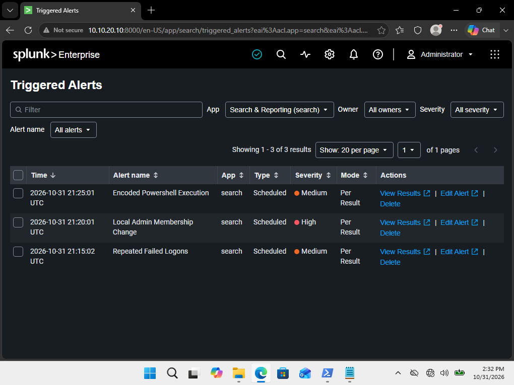
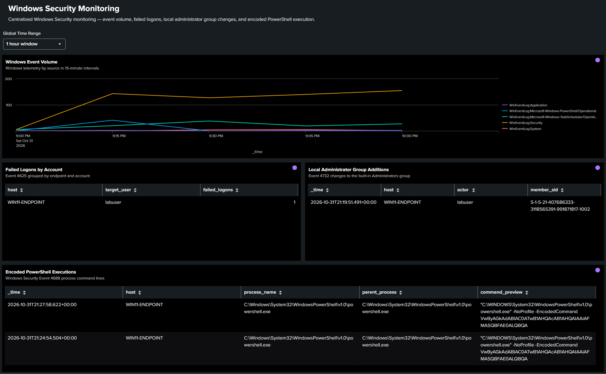
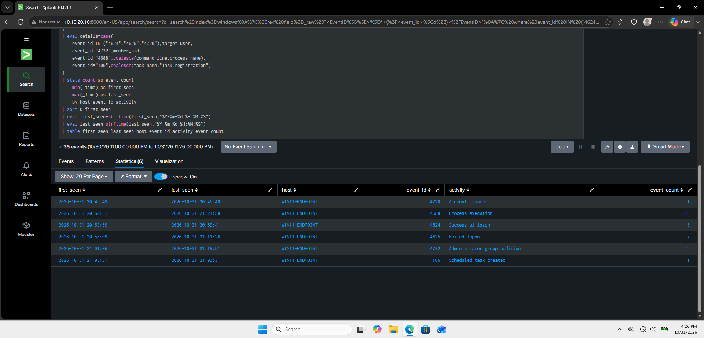

# Splunk SIEM Detection & Incident Investigation Lab

**Status: Complete**

A hands-on cybersecurity project focused on building a Splunk SIEM environment, detecting suspicious Windows activity, and investigating a controlled security incident.

The lab demonstrates practical experience with Windows log collection, SPL detection engineering, scheduled alerting, security monitoring, incident investigation, and containment verification.

## Lab Environment

The environment consists of two VirtualBox virtual machines connected through an isolated internal network.

| System | Operating System | IP Address | Purpose |
|---|---|---|---|
| SPLUNK-SERVER | Ubuntu 24.04 LTS | 10.10.20.10 | Splunk Enterprise |
| WIN11-ENDPOINT | Windows 11 | 10.10.20.20 | Monitored endpoint |

**Technologies:** Splunk Enterprise, Splunk Universal Forwarder, Windows Event Logs, PowerShell, SPL, Sigma, VirtualBox, Ubuntu Linux.

Windows Security, PowerShell Operational, and Task Scheduler Operational events were forwarded to Splunk for analysis.

The lab used raw Windows event XML and manual SPL field extraction without the Splunk Add-on for Microsoft Windows.

## Detection Engineering

Implemented and tested three SPL detections with scheduled Splunk alerts.

| Detection | Event ID | Purpose |
|---|---|---|
| Repeated Failed Logons | 4625 | Identify three or more failed logons for the same account and host within two hours |
| Local Administrator Group Addition | 4732 | Monitor additions to the built-in Administrators group |
| Encoded PowerShell Execution | 4688 | Detect PowerShell processes launched with encoded-command arguments |

All three alerts were successfully triggered and verified in Splunk.

Equivalent Sigma definitions were created to document the detection logic in a vendor-neutral format.

**Detection files:**
- [SPL Detections](detections/spl/)
- [Sigma Rules](detections/sigma/)

### Triggered Alerts

## Security Monitoring Dashboard

Built a Splunk Dashboard Studio dashboard containing four monitoring panels:

- Windows event volume over time
- Failed logons by account
- Local Administrators group additions
- Encoded PowerShell executions

The dashboard includes a global time-range selector for investigating different periods of activity.

[View Dashboard JSON](dashboards/windows-security-monitoring.json)

## Incident Investigation

Conducted a controlled simulation involving account creation, authentication failures, successful logons, privilege changes, encoded PowerShell execution, system discovery, and scheduled-task creation.

The investigation included:

- Correlating events across multiple Windows log sources.
- Reconstructing the sequence of activity.
- Reviewing triggered alerts and associated event evidence.
- Mapping observed behaviors to MITRE ATT&CK.
- Investigating account deletion and administrator-group membership removals.
- Verifying removal of the temporary account and scheduled task.

The broad investigation search analyzed **1,593 Windows events across nine selected event IDs**, with a focused timeline identifying **35 relevant simulated activity events**.

All three detection alerts triggered successfully, and cleanup was verified through Windows event records and endpoint checks.

### Investigation Evidence

**Additional evidence:**
- [Chronological Incident Timeline](screenshots/phase6-incident-timeline.png)
- [Incident Cleanup Verification](screenshots/phase6-incident-cleanup.png)
- [Full Incident Investigation Report](docs/incident-report.md)

## Key Takeaways

- Configured end-to-end Windows log forwarding into Splunk Enterprise.
- Developed and tested SPL detections against raw Windows event XML.
- Configured three scheduled security alerts and validated their triggering behavior.
- Built a centralized security monitoring dashboard with multiple investigation views.
- Reconstructed a simulated incident using authentication, account management, process creation, and scheduled-task telemetry.
- Documented MITRE ATT&CK mappings, false positives, investigation limitations, and cleanup verification.

## Project Roadmap

See [ROADMAP.md](docs/ROADMAP.md) for the project phases and implementation details.

## Disclaimer

This project was performed in an isolated virtual lab using systems under my control. All suspicious activity was intentionally simulated using harmless commands for defensive security practice. No malware or unauthorized access was involved.